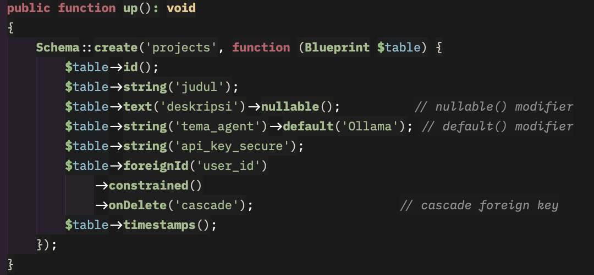
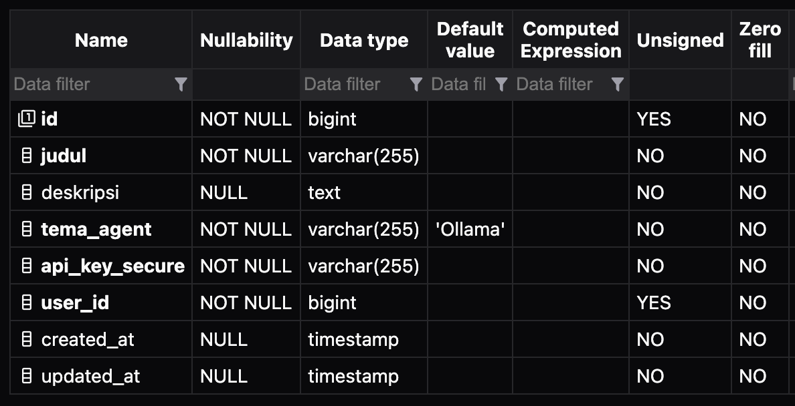
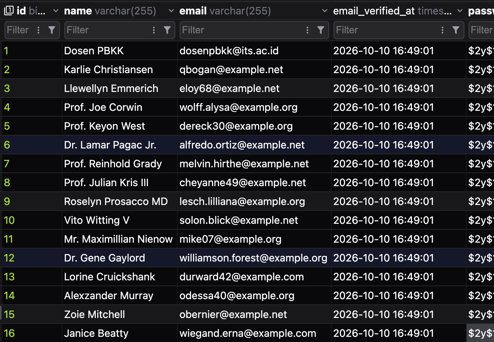
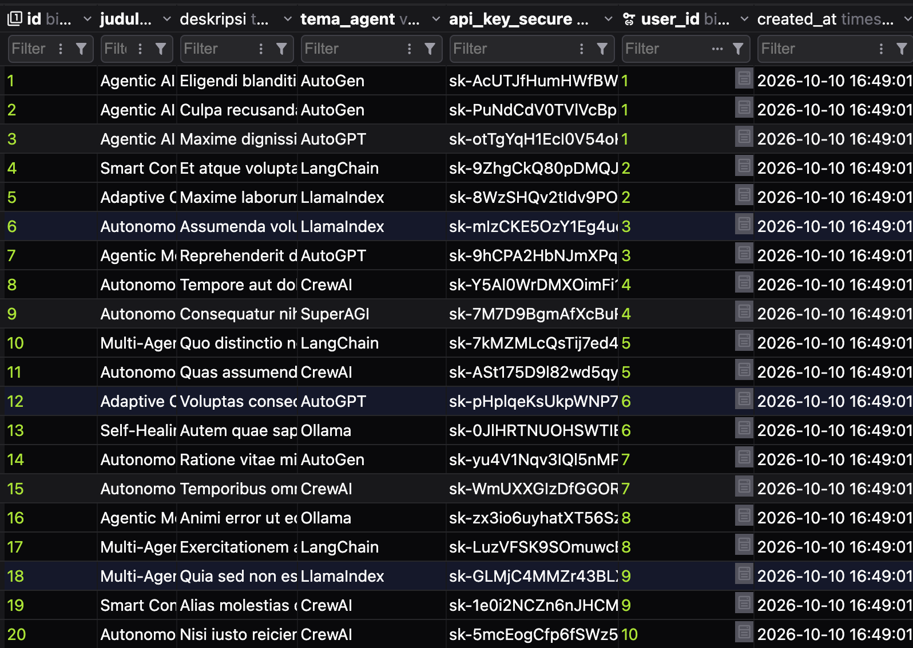
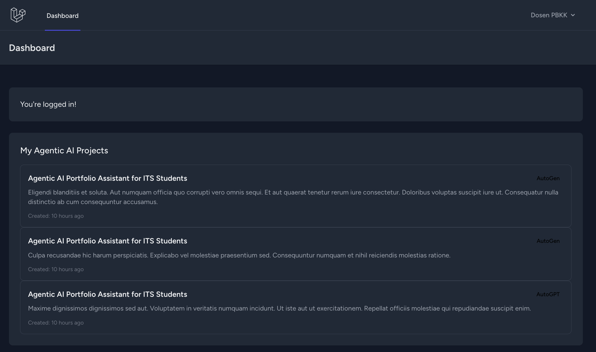
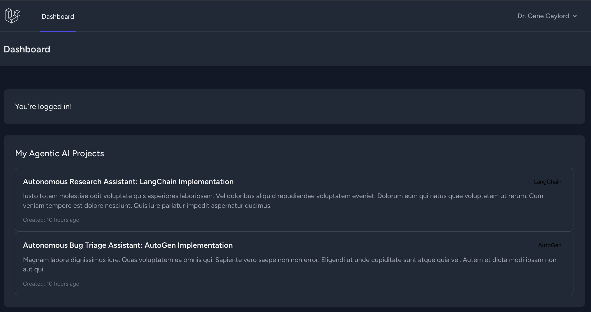

# PBKK-W6

Tugas minggu ke-6 kelompok 2, portal Laravel yang menyimpan user profiles dengan projectnya.

> **Demo Account**
> - Email: dosenpbkk@its.ac.id
> - Password: password


> Dont forget to prepare these dependencies ^^

---

- [How to Run](#how-to-run)
  - [Laravel App](#laravel-app)
  - [MySQL Database](#mysql-database)
- [Grading Criteria](#grading-criteria)
  - [Rancangan Skema Migration](#penilaian-rancangan-skema-migration)
  - [Pemodelan Data & Mass Assignment Guard](#penilaian-pemodelan-data--mass-assignment-guard)
  - [Factories & Seeders Orkestrasi](#penilaian-factories--seeders-orkestrasi)
  - [Integritas Query di Dashboard](#penilaian-integritas-query-di-dashboard)
  - [Kerapian Kode & Standar PSR-12](#penilaian-kerapian-kode--standar-psr-12)

## How to Run

### Laravel App

```bash
# 1. Install PHP and Node dependencies
composer install
npm install

# 2. Create the environment file and generate an app key
cp .env.example .env
php artisan key:generate

# 3. Build frontend assets
npm run build

# 4. Run migrations and seeders (see MySQL section below first)
php artisan migrate:fresh --seed

# 5. Serve the app
php artisan serve
```

Then open `http://127.0.0.1:8000` and log in with the demo account.

### MySQL Database

The database runs in a Docker container with a named volume for persistence.
The Laravel app on the host connects to it over `127.0.0.1:3307`.

```bash
# 1. Start the MySQL container
docker compose up -d

# 2. Wait until MySQL reports "ready for connections" (first boot takes ~10s)
docker logs -f laravel_mysql
# Ctrl+C once the ready message appears

# 3. Run migrations and seeders from the host
php artisan migrate:fresh --seed
```

The `.env` file must contain these values (already preset in `.env.example`):

```ini
DB_CONNECTION=mysql
DB_HOST=127.0.0.1
DB_PORT=3307
DB_DATABASE=laravel
DB_USERNAME=laravel
DB_PASSWORD=
DB_ROOT_PASSWORD=
```

Fill `DB_PASSWORD` and `DB_ROOT_PASSWORD` with any local value you choose.
Do **not** commit the resulting `.env` file — it is gitignored.

To reset the database and wipe the volume:

```bash
docker compose down -v
docker compose up -d
php artisan migrate:fresh --seed
```

> If you do not have docker installed, you can use your MySQL and configure the db_username and db_database yourself. Don't forget to change the port into 3306 (default MySQL port).

## Grading Criteria

### Penilaian Rancangan Skema Migration

**Bobot: 35%**

- `database/migrations/2026_10_10_142654_create_projects_table.php` mendefinisikan tabel `projects`
  dengan tipe data yang tepat: `string` untuk judul, `text` untuk deskripsi, `string` untuk tema_agent
  dan api_key_secure.
- Foreign key `user_id` menggunakan `foreignId()->constrained()->onDelete('cascade')` sehingga
  menghapus user otomatis menghapus project miliknya.
- Column modifiers: `nullable()` pada `deskripsi`, `default('Ollama')` pada `tema_agent`.
- Tabel `users` bawaan Laravel Breeze sudah menerapkan `unique()` pada kolom `email`.

| Code | Project Table |
| :--: | :----: |
|  |  |

### Penilaian Pemodelan Data & Mass Assignment Guard

**Bobot: 25%**

- Model `App\Models\Project` mengikuti konvensi penamaan Laravel (singular PascalCase, tabel plural).
- Array `$fillable` pada `Project` mendaftarkan `judul`, `deskripsi`, `tema_agent`, `api_key_secure`,
  dan `user_id` untuk mencegah mass-assignment.
- Relasi Eloquent didefinisikan dua arah: `Project::user()` (`belongsTo`) dan `User::projects()`
  (`hasMany`).
- Model `User` memakai cast `'password' => 'hashed'` sehingga password otomatis di-hash saat
  di-assign.

> Check the file here [app/Models/Project.php](app/Models/Project.php)

### Penilaian Factories & Seeders Orkestrasi

**Bobot: 20%**

- `Database\Factories\ProjectFactory` memakai Faker untuk menghasilkan judul proposal Agentic AI
  yang realistis dari daftar tema (`Ollama`, `LangChain`, `CrewAI`, dll.) dan subjek (`Autonomous
  Research Assistant`, `Multi-Agent Code Reviewer`, dll.).
- `DatabaseSeeder` membuat **15 user mahasiswa acak**, masing-masing dengan **2 project dummy**
  via `User::factory()->count(15)->has(Project::factory()->count(2))->create()`.
- Akun demo `dosenpbkk@its.ac.id` (password `password`) disiapkan dengan 3 project siap presentasi.
- `UserFactory` menggunakan `fake()->unique()->safeEmail()` sehingga tidak ada duplikasi email.

| Users Seed Result | Project Seed Result |
| :---------------: | :------------------ |
|  |  |

### Penilaian Integritas Query di Dashboard

**Bobot: 10%**

- `DashboardController` menjalankan `$request->user()->projects()->latest()->get()`.
- Query hanya menarik project milik user yang sedang login — tidak ada data user lain yang bocor.
- `latest()` mengurutkan berdasarkan `created_at DESC` sesuai permintaan rubrik.
- Karena memakai Eloquent query builder, binding parameter dilakukan otomatis sehingga aman dari
  SQL Injection.
- View `resources/views/dashboard.blade.php` menampilkan judul, tema_agent, deskripsi, dan waktu
  pembuatan project dengan escaping `{{ }}` bawaan Blade.

| User Demo Dosen | User hasil Seeder |
| :-------------: | :---------------- |
|  |  |

### Penilaian Kerapian Kode & Standar PSR-12

**Bobot: 10%**

- Seluruh file PHP diformat dengan `vendor/bin/pint` (Laravel Pint, preset PSR-12).
- `.gitignore` aktif sehingga folder `vendor/`, `node_modules/`, `public/build/`, dan file `.env`
  tidak ter-commit.
- README ini mendokumentasikan langkah setup lokal (`composer install`, `php artisan migrate --seed`,
  `docker compose up -d`).
